# agentic-etl

**AI writes the code that loads messy files into a data warehouse, and proves it with tests before anything loads.**

## What it does

You give it a spreadsheet, CSV or JSON export from a bank, a supplier, a till system or a sensor, laid out however
that system likes. It works out what is in the file, suggests where each column belongs in your company's database,
writes the small program that moves the data across, and tests that program against the file. Only a version that
passes every test is allowed to load. Bad records are set aside with the reason, never quietly dropped.

## A real-life example

Emma is the only data person at Acme Home & Garden, an Auckland garden-and-hardware chain with four stores (an
invented business). Every month she receives about thirty files: bank statements from two banks, price lists
from six suppliers, till exports, timesheets, cold-store sensor dumps and a customer list. Each one has its own
layout: a German supplier writes `12,50 €`, one bank splits money in and money out into two columns, the sensor
gateway reports Fahrenheit. Before, a new layout cost her most of a morning to write and check a loader by hand,
and a quiet change (a renamed column, a new date format) could fill a report with blanks before anyone noticed.

With agentic-etl she drops the file in, reads the suggested column matches on one page and clicks approve. The
tool writes and tests the loader in under a minute, sets aside the three suspicious lines in April's bank statement
(a repeated transaction, one with no reference and one dated 2031) and loads the other 26. When the sensor
gateway switched to Celsius in April, the change was caught and the load waited for her instead of storing
temperatures converted twice. On the 36 test files the AI path loaded 34 exactly right, for about a tenth of a
US cent of model time per file.

## How you would use it

1. Put the file in a folder and run `etl run <file> --yes` (or `etl map <file>` to look first).
2. Open the review page (`etl serve`): each warehouse column shows which file column feeds it, how it is
   converted, sample values and why it was chosen. Change anything that looks wrong.
3. Click **Run the data tests**, then **Approve**.
4. Next month, run `etl run` on the new file. If its layout changed, run `etl drift`: it explains what changed,
   proposes an updated mapping and tests it.
5. Look at the **Tests** and **Runs & audit** tabs to see what loaded, what was held back and why.

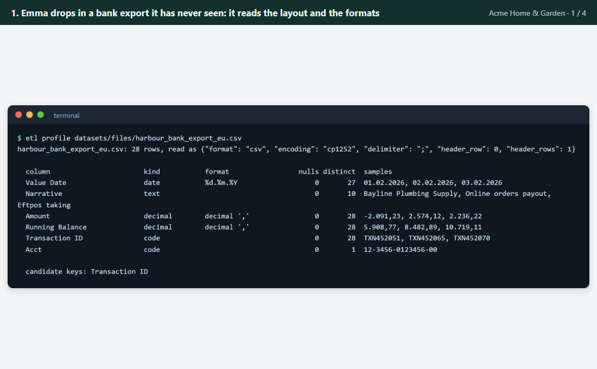

*The example above in four steps, using screens from a real run on the Acme files: reading an unfamiliar bank
export, reviewing the suggested matches, the tests holding back three bad lines, and the Celsius change waiting
for a person.*

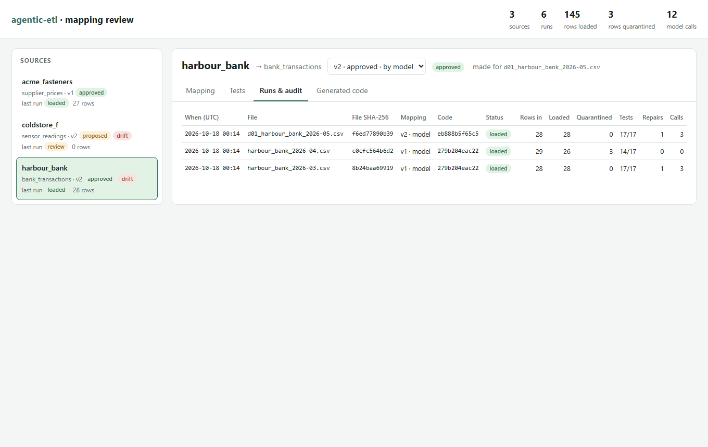

*The review page in use: the April bank run with its quarantined lines, then the sensor source whose layout
changed, re-tested and approved by a person, and the code the model wrote.*

## Screenshots

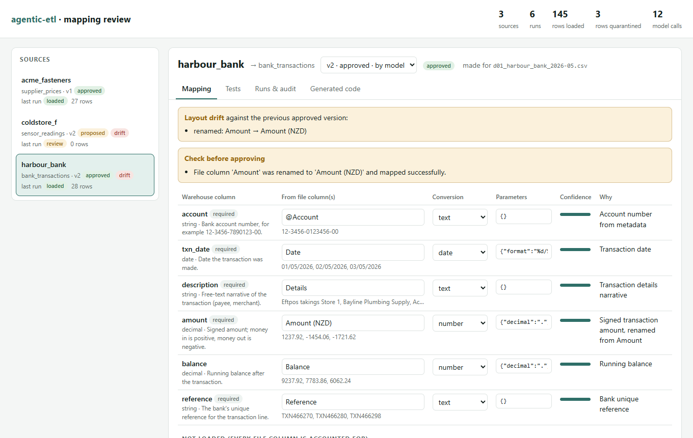

*The mapping review. A layout change (a renamed column) is flagged at the top; each warehouse column shows where its
values come from and sample values, so a person can check the match at a glance.*

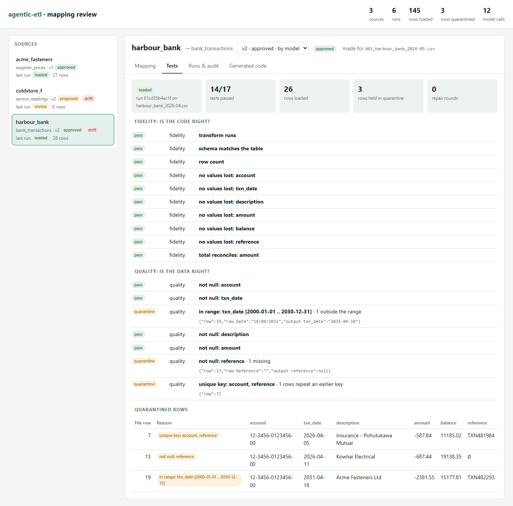

*Test results for April's bank statement. The code passed every fidelity test; three rows broke quality rules and
were held back with the reason, while the other 26 loaded.*

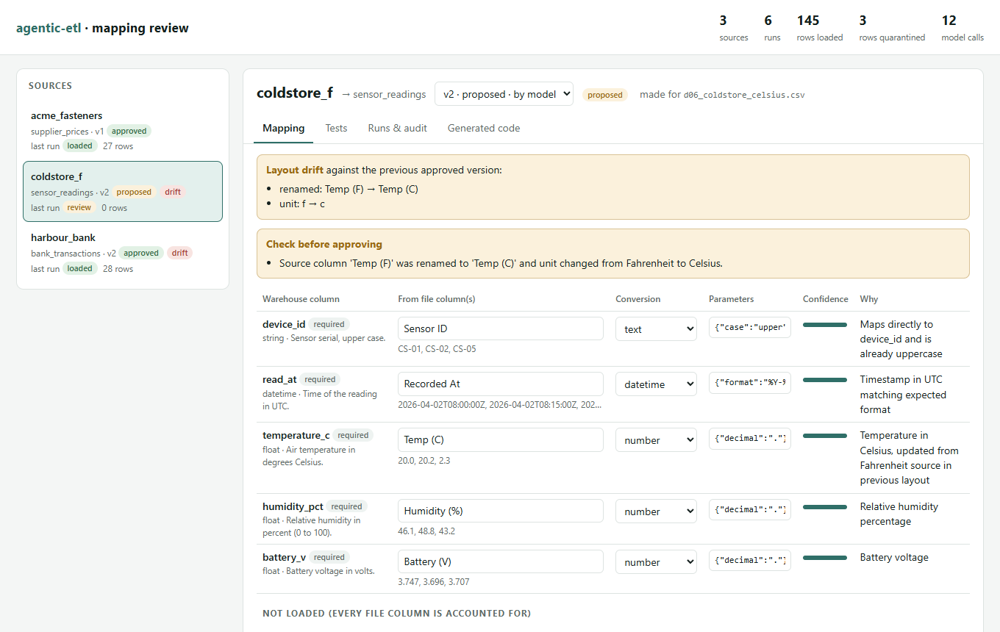

*Layout drift. The sensor gateway now reports Celsius; the updated mapping stops converting from Fahrenheit and
waits for approval because a unit changed.*


*The audit trail: every run records the file's SHA-256 hash, the mapping and code versions, the tests and the rows
loaded or held back. The second run re-used the code already proven for that mapping, so it needed no model call.*

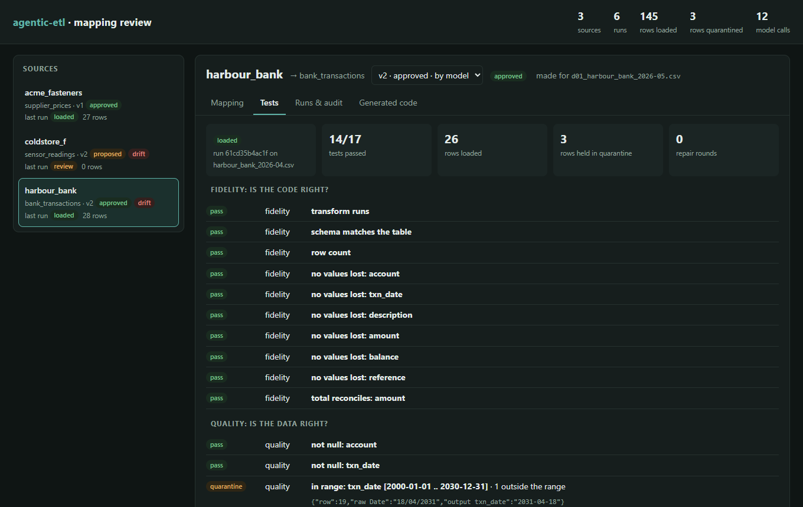

*The same page in dark mode.*

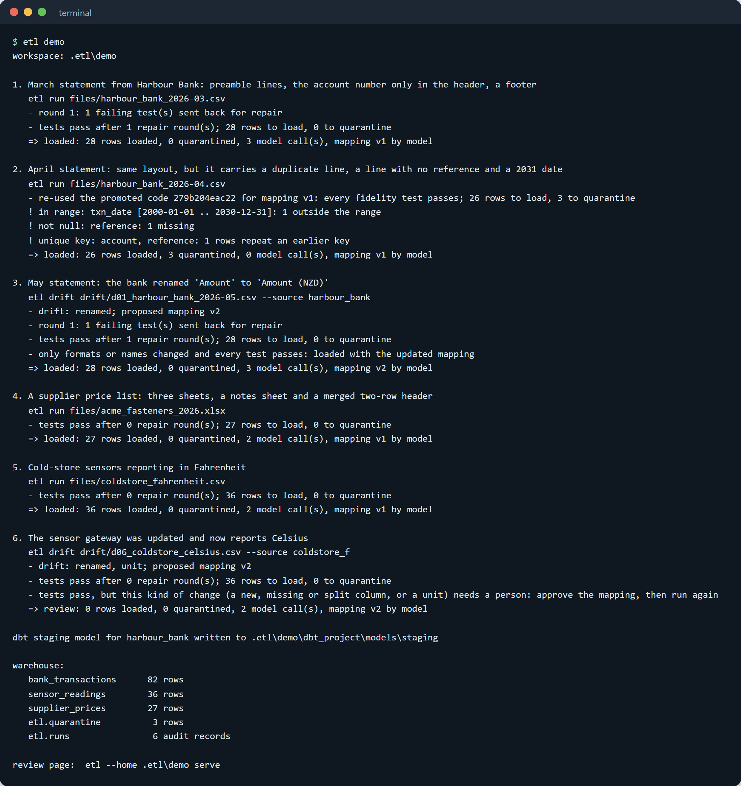

*`etl demo` runs the whole story from recorded model replies, with no key.*

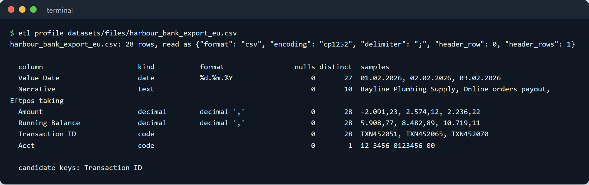

*`etl profile` on a European-style bank export: the encoding, delimiter, decimal commas and date format are
detected before any code is written.*

---

## How it works

1. **Read.** `readers.py` detects the encoding (UTF-8, byte-order marks, UTF-16, Windows-1252), the delimiter,
   the header row, title and footer lines, merged two-row Excel headers, which sheets share a layout, the record
   list inside nested JSON, and fixed-width column boundaries. Everything stays as text. Lines that are not data
   (a "Closing balance" footer, a cover sheet) are kept and written to the run record. Values found outside the
   table, such as an account number in a title line, become `@` columns.
2. **Profile.** `profile.py` finds each column's kind (date, timestamp, money, number, phone, email, code, text),
   its exact format (`%d.%m.%Y`, epoch seconds, decimal comma, `NZ$`, `°C`, `h:mm`), nulls, units in headers and
   candidate keys. Ambiguous dates (day/month or month/day) are flagged for review.
3. **Map.** The model reads the profile and the warehouse catalogue (names, types, descriptions, rules) and
   returns a JSON mapping: for each warehouse column, the source column(s) and one conversion from a fixed
   vocabulary (`number`, `date`, `debit_credit`, `f_to_c`, `phone_e164` and so on). Every file column must be used
   or listed as not loaded, with a reason. Without a key, a rules mapper does the same job from alias lists.
4. **Generate.** The model writes a small Polars `transform(raw)` function that implements the mapping. Without a
   key, `compile.py` turns the mapping into the same kind of function from hand-written helpers.
5. **Test in a sandbox.** `sandbox.py` checks the code statically (allowed imports only; no file, network or
   reflection calls) and runs it in a separate `python -I` process with a time limit. `checks.py` then runs two
   families of data tests:
   * **Fidelity** (is the code right?): the schema, every row kept, no value turned into an empty one, and totals
     that reconcile with an independent parse of the source.
   * **Quality** (is the data right?): required values, unique keys, allowed codes, plausible ranges.
6. **Repair.** If a fidelity test fails, the failing tests and example rows go back to the model, which returns a
   corrected version, up to three rounds. A quality failure on a few rows is bad data, not bad code: those rows are
   quarantined. A quality failure on most rows is treated as a code problem.
7. **Load.** Only a version that passes every fidelity test is promoted. Clean rows go to the DuckDB table,
   held-back rows to `etl.quarantine` with their reasons, the raw text to `raw.<source>`, and an audit row to
   `etl.runs`. The promoted code is re-used for the next file with the same mapping.
8. **Drift.** `drift.py` compares a new file with the fingerprint of the file the mapping was approved for:
   read changes, renamed, added, removed, reordered and split columns, value formats and units. It proposes an
   updated mapping and re-tests. Renames and format changes load once the tests pass; new, missing or split columns
   and unit changes wait for a person; a missing required column blocks the load.
9. **dbt.** `etl dbt <source>` writes the approved mapping as a dbt staging model (DuckDB SQL) with a schema file of
   dbt tests, so the same load can live in a dbt project.

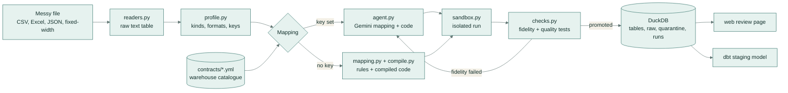

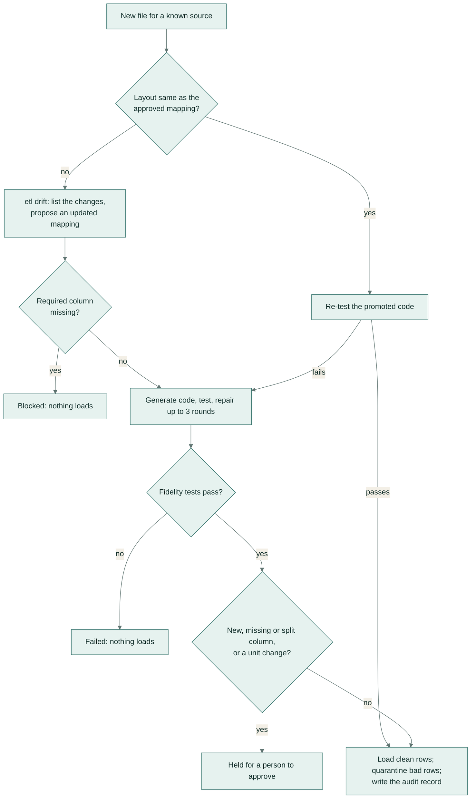

## Evaluation

**Data.** 36 messy files from six invented sources (two banks, six suppliers, a till system, timesheets, cold-store
sensors, a CRM), each with a hand-checked gold table, built by `datasets/build.py`. Six files carry 18 planted data
problems (duplicate keys, missing keys, out-of-range values, an unknown currency). Ten drift scenarios cover a
renamed column, changed date, number and hour formats, an added column, a reordered layout, a Fahrenheit to Celsius
switch, a new delimiter, a split name column and a removed key column. Everything is invented; no public data is
used.

**How it is measured.** `etl eval` loads every file with each approach and compares the loaded table with gold:
*exact* means every row and every cell match (money to the cent, sensor values within their stated tolerance);
*cells* is cell accuracy with rows matched by position; *planted caught* counts planted problems flagged by the
expected test; *false q* counts rows quarantined in clean files; *silent loss* counts files where rows disappeared
without a record or a loaded value is empty where gold has one. Model replies were recorded on 2026-10-18 with
`gemini-flash-lite-latest` (107 calls in total), and the cost uses the Flash-Lite list price of $0.10 / $0.40 per
million input / output tokens.

| Approach | Exact files | Cell accuracy | Loaded | Planted caught | False quarantines | Silent loss | Model calls / file | US$ / file |
|---|---|---|---|---|---|---|---|---|
| Baseline: pandas defaults + name matching | 0 / 36 | 13.2% | 30 | 0 / 18 | 0 | 10 files | 0 | 0 |
| Rules mapper + compiled code (no model) | 26 / 36 | 78.9% | 29 | 18 / 18 | 0 | 1 file | 0 | 0 |
| Model mapping + compiled code | 34 / 36 | 96.9% | 35 | 18 / 18 | 0 | 0 | 1.0 | 0.0005 |
| Model mapping + model code, first try | 26 / 36 | 74.7% | 27 | 12 / 18 | 0 | 0 | 2.0 | 0.0008 |
| **Model mapping + model code, after repair (≤ 3 rounds)** | **34 / 36** | **96.9%** | 35 | **18 / 18** | 0 | **0** | 2.36 | 0.0009 |

| Drift scenarios (10) | Handled correctly |
|---|---|
| Baseline: pandas defaults + name matching | 0 |
| Approved mapping re-used, no drift step (the tests still guard the load) | 3 |
| Drift detection + rules update | 9 |
| Drift detection + model update | 9 |

What the numbers say:

* The repair loop is where the model earns its place: the first version of the code was right for 26 files, and
  feeding failing tests back raised that to 34, using 13 repair rounds in total.
* The two misses are visible, not silent. One file failed every repair round (Unix timestamps in Polars 2), so
  nothing loaded. In the other, the model chose to upper-case supplier names; every test passed because nothing in
  the contract forbids it, which is why a person approves each new mapping.
* The baseline loads 30 files without complaint and gets none right; ten of them lose values or rows silently.
* The rules mapper is strong where the catalogue's alias lists cover the headers and fails where they do not
  (German headers, fixed-width abbreviations, nested JSON names).
* In one drift scenario the key column disappeared and the model proposed filling it with a constant empty value;
  the mapping check treats that as a missing source and blocks the load.

Replay the whole evaluation offline (no key) and compare it with the committed results:

```bash
etl eval --offline --check eval/results.json
```

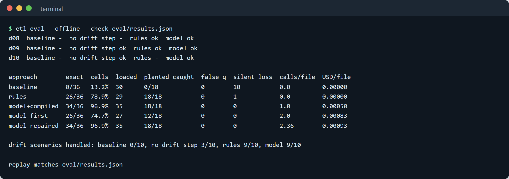

*The evaluation replayed from the recorded model replies; `--check` confirms it matches `eval/results.json`.*

## Tech stack

* **Python 3.11+**, **Polars 2** (transforms), **DuckDB** (warehouse, audit, quarantine), **openpyxl** (Excel),
  **pandas** (the baseline only), **PyYAML** (contracts, dbt files).
* **Gemini** (`gemini-flash-lite-latest`) through its OpenAI-compatible endpoint, called with the standard library;
  every reply is cached on disk and replayed offline.
* Review page: the standard-library HTTP server and one HTML file with plain JavaScript.
* Quality: ruff, mypy, pytest, GitHub Actions.

## Setup and usage

```bash
python -m venv .venv && . .venv/bin/activate      # Windows: .venv\Scripts\activate
python -m pip install -e ".[dev]"                  # or: make setup
etl demo                                           # the Acme story, no key needed (make demo)
etl --home .etl/demo serve                         # review page on http://127.0.0.1:8765
```

Everyday commands:

```bash
etl profile FILE                     # what is in the file
etl map FILE [--source NAME]         # propose a mapping, saved as a new version
etl approve NAME                     # approve the latest version
etl generate FILE [--show-code]      # write and test the transform without loading
etl run FILE [--yes]                 # test and load with the approved mapping
etl drift FILE --source NAME         # explain a layout change, propose and test an update
etl dbt NAME --out dbt_project       # write the dbt staging model and tests
etl eval [--offline]                 # the evaluation
```

Configuration (environment variables; names only):

| Variable | Purpose |
|---|---|
| `AI_API_KEY` | Gemini key. Without it, the rules engine runs, and recorded replies replay. |
| `AI_BASE_URL`, `AI_MODEL` | Any OpenAI-compatible endpoint and model (default: Gemini, `gemini-flash-lite-latest`). |
| `AI_MIN_INTERVAL` | Seconds between live calls (default 4.5). |
| `AI_MAX_CALLS` | Live-call budget per process (default 150). |
| `ETL_HOME` | Workspace folder (default `.etl`). |
| `ETL_CONTRACTS` | Folder of warehouse table contracts (default `contracts/`). |
| `ETL_CACHE` | Recorded model replies (default `cache/`). |

`--engine rules|model|auto` picks who maps and writes code; `auto` uses the model when a key is set.

## Project structure

```
agentic_etl/
  readers.py     encoding, delimiter, headers, sheets, JSON records, fixed width -> raw text table
  profile.py     column kinds, formats, number styles, units, candidate keys
  contracts.py   warehouse table contracts (types, keys, ranges, allowed values)
  mapping.py     the mapping format, its checks, the rules mapper, table routing, new-table proposals
  agent.py       the model prompts: map, write code, repair, update after drift
  compile.py     mapping -> Polars code and DuckDB SQL
  sandbox.py     static code check + isolated child process (_child.py)
  checks.py      fidelity and quality data tests, quarantine
  pipeline.py    profile -> map -> generate -> test -> repair
  drift.py       drift detection and rules-based mapping updates
  store.py       versioned mappings and code, DuckDB load, quarantine and audit
  service.py     the commands behind the CLI and the review page
  dbt.py         dbt staging model, schema tests and source file
  evaluate.py    the evaluation; baseline.py is the pandas baseline; gold.py scores against gold
  web/           review page (server.py, index.html)
contracts/       the six warehouse tables
datasets/        build.py, 36 files, 10 drift files, gold tables, manifest.json
cache/llm/       recorded model replies (replayed offline)
eval/            results.json
tests/           pytest suite
```

## Tests

```bash
make test        # ruff, ruff format --check, mypy, pytest
```

68 tests cover the readers on every file, profiling, routing and new-table proposals, the mapping checks, the
fidelity tests catching wrong code (a wrong date format, an ignored decimal comma, dropped rows), the sandbox
rejecting unsafe code, quarantine of every planted problem, the dbt SQL matching the Polars transform, drift
detection on all ten scenarios, the workspace (idempotent re-runs, audit, code re-use), the review page API, and
offline replay of recorded model runs. CI runs the same commands, then `etl demo` and the offline evaluation replay;
it never calls a model.

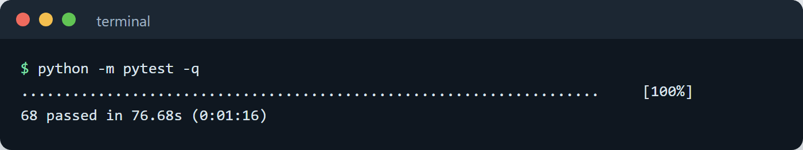

## Licence

MIT. See [LICENSE](LICENSE).
